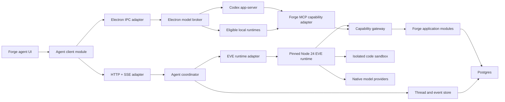

# Forge agent platform: final implementation plan

Status: approved implementation plan  
Date: 2026-07-23  
Scope: Forge web and macOS desktop

## 1. Outcome

Forge will ship an agent experience that:

- opens from any page without replacing the current page;
- starts from a centered composer on the Forge home page;
- supports compact floating chats and a maximized overlay;
- keeps multiple open chats in bottom tabs and exposes searchable history;
- streams assistant text, progress, tools, code, file search, reads, edits, approvals, and artifacts as structured events;
- uses Vercel EVE for Forge-native agents with both typed Forge tools and isolated code execution;
- lets users manually choose a model or use OpenAI-only Auto;
- supports API-key connections inside the Forge/EVE harness;
- supports eligible consumer subscriptions through official local agent runtimes such as Codex app-server; and
- preserves Forge authorization, approvals, idempotency, auditability, and workspace isolation regardless of model.

The first production release is intentionally narrower:

1. OpenAI API-key models.
2. OpenAI-only Auto routing.
3. Local Codex/ChatGPT subscription through Codex app-server.
4. Read-only Forge tools.
5. Isolated code over bounded tool results.
6. Explicit approval before every material write.

Anthropic and other API-key providers follow after this vertical slice. Additional consumer-subscription adapters remain gated by provider policy and a supported embedding interface.

## 2. Decisions already made

These are implementation constraints, not open questions:

1. **EVE is the Forge-native harness.** Pin an exact beta version and isolate it behind a Forge-owned runtime adapter.
2. **Tools and code have different trust levels.** Forge capabilities are typed, authorized tools. Generated code runs in an isolated sandbox without ambient database credentials, provider keys, or Forge server environment variables.
3. **API providers and subscription runtimes are different execution planes.** An API key supplies a model to the Forge/EVE loop. A CLI subscription supplies a separate provider-owned agent loop.
4. **Auto is OpenAI-only.** It never silently routes to Anthropic, Gemini, Kimi, xAI, Mistral, DeepSeek, MiniMax, or a custom endpoint.
5. **The current page remains mounted.** Compact and maximized chats are overlays. Maximizing never navigates to a dedicated agent page.
6. **Forge home is composer-first.** `/forge` contains the centered composer and lightweight suggestions, not an embedded conversation.
7. **The Atrium model selector is the selector implementation.** Forge reuses the compact/advanced/model/effort interaction already ported to `src/components/agent/composer-model-picker.tsx`.
8. **Every action uses the current `Actor`.** No agent path bypasses workspace membership, role checks, credential scopes, or application modules.
9. **Writes are idempotent and approval-gated.** EVE can replay interrupted steps, so external mutations must be safe to repeat.
10. **Forge never extracts CLI OAuth credentials.** Official login flows and official process interfaces own authentication and refresh.

Supporting research:

- [EVE agent harness assessment](../research/eve-agent-harness.md)
- [Model providers, subscriptions, and Auto routing](../research/forge-model-providers.md)

## 3. Current repository baseline

Forge already has useful seams:

- TanStack Start and React for the shared renderer.
- Electron main/preload isolation and a validated IPC bridge.
- Better Auth sessions and API keys.
- An application-level `Actor`.
- Scope and workspace-role authorization.
- oRPC/OpenAPI handlers, idempotency storage, and API audit helpers.
- Drizzle/Postgres persistence.
- Base UI-backed shadcn components.
- A placeholder `/agent` route and placeholder `/forge` page.
- Footer actions for Ask Forge and History.
- A port of Atrium's animated model selector plus initial OpenAI model definitions.

The main missing pieces are:

- the agent shell and state coordinator;
- durable thread/run/event persistence;
- the EVE runtime;
- the capability gateway;
- sandboxed programmatic code;
- provider connections and credential storage;
- local runtime supervision;
- approval and artifact UX; and
- production evals and observability.

Only the teams application module is currently deep enough to expose as a Forge tool. Issue, project, signal, call, review, and insight tools must be added only after their application modules exist; tools must not query tables directly.

## 4. System architecture



### 4.1 Deep modules and seams

#### Agent client module

The UI learns one interface:

```ts
type AgentClient = {
  dispatch(command: AgentCommand): Promise<AgentCommandResult>
  subscribe(threadId: string, cursor?: string): AsyncIterable<AgentEvent>
}
```

`AgentCommand` is a discriminated union for:

- `thread.create`
- `turn.start`
- `run.cancel`
- `approval.resolve`
- `thread.rename`
- `thread.archive`
- `thread.close`
- `thread.reopen`

Two adapters make this a real seam:

- HTTP/SSE for Forge-native and web execution.
- Electron IPC for local subscription runtimes.

The React tree does not import EVE, Codex, Claude, or provider SDKs.

#### Agent coordinator module

The coordinator owns:

- actor and workspace validation;
- thread/run creation;
- model resolution;
- execution-plane selection;
- runtime session handles;
- event normalization;
- cancellation;
- approval routing;
- persistence; and
- recoverable error mapping.

Its implementation chooses the EVE adapter or a local-runtime adapter from the selected connection. The UI never makes this decision.

#### Capability gateway module

The gateway is the only way an agent or generated program invokes Forge behavior:

```ts
type CapabilityGateway = {
  list(input: CapabilityListInput, context: AgentExecutionContext):
    Promise<Array<CapabilityDescriptor>>
  invoke(input: CapabilityInvocation, context: AgentExecutionContext):
    Promise<CapabilityResult>
}
```

It owns:

- capability discovery;
- input and output validation;
- `Actor` authorization;
- workspace scoping;
- risk classification;
- approval requirements;
- idempotency keys;
- timeouts;
- result-size limits;
- audit records; and
- safe error redaction.

Adapters expose the same gateway as:

- EVE-authored tools;
- a run-bound sandbox SDK;
- an MCP server for local agent runtimes; and
- in-memory fakes for contract tests.

#### Model registry module

The registry merges:

- server-capable API connections;
- Forge-managed models, when enabled;
- desktop-only runtime connections;
- live provider catalogs;
- Forge capability metadata; and
- policy/health state.

It returns connection-qualified model references. `gpt-5.6-sol` through Codex and through an OpenAI API key are different selections.

#### Model router module

The router has one job:

```ts
resolveModel(input: RoutingInput): Promise<ResolvedModel>
```

It converts Auto or manual selection into an immutable per-run resolution. It does not execute models and does not weaken safety policy.

#### Event store module

The event store appends normalized events idempotently and materializes thread summaries. Runtime-specific checkpoints remain in EVE or the local provider runtime; Forge's event log remains the provider-neutral product history and audit trail.

### 4.2 Proposed Forge layout

```text
src/application/agents/
  agent-contract.ts
  agent-coordinator.server.ts
  agent-authorization.ts
  capability-contract.ts
  capability-gateway.server.ts
  event-contract.ts
  event-store.server.ts
  model-contract.ts
  model-registry.server.ts
  model-router.server.ts

src/adapters/agents/
  eve-runtime.server.ts
  fake-runtime.ts
  forge-capability-tools.server.ts
  forge-mcp.server.ts
  provider-catalogs/

src/lib/agent-client/
  agent-client.ts
  http-agent-client.ts
  desktop-agent-client.ts

src/routes/api/agent/
  threads.ts
  runs.ts
  events.ts
  approvals.ts
  local-ingest.ts
```

The route files validate transport input and delegate immediately. Business rules remain in `src/application/agents`.

### 4.3 Product endpoints

Expose the following behavior through typed oRPC contracts and HTTP/SSE adapters:

- create/list/read/rename/archive threads;
- start a turn;
- subscribe to events after a cursor;
- cancel a run;
- resolve an approval;
- upload bounded local-runtime events;
- list/refresh model catalogs;
- create/test/delete provider connections; and
- fetch artifacts through authorized, expiring URLs.

Every endpoint resolves an `Actor` before entering the application module. Local event ingestion uses a short-lived run-scoped token in addition to the authenticated user session.

## 5. Runtime topology

### 5.1 Forge-native EVE runtime

Create a Node 24 workspace beside the TanStack application:

```text
services/agent-runtime/
  package.json
  src/
    agent/
      instructions.md
      agent.ts
      tools/
    channel/
      forge-channel.ts
    events/
      normalize-eve-event.ts
    models/
      resolve-eve-model.ts
    sandbox/
      forge-program-runtime.ts
```

Rules:

- Pin EVE and Workflow dependencies exactly.
- Keep the EVE compiler/server lifecycle out of the Bun/TanStack process.
- Proxy the runtime through the Forge origin in production.
- Authenticate every channel request and reconstruct an `Actor`.
- Use a separate Postgres namespace for EVE workflow state.
- Treat EVE workflow state as execution infrastructure, not product history.
- Wrap EVE events in the canonical Forge event schema.
- Do not import EVE internals outside this workspace.

Production code execution uses a supported isolated sandbox backend with:

- no ambient Forge secrets;
- no database credentials;
- deny-all public network egress by default;
- CPU, memory, disk, output, and wall-clock limits;
- per-run workspace isolation; and
- automatic teardown and artifact collection.

### 5.2 Local external runtimes

Create the desktop broker in Electron main:

```text
electron/main/model-broker/
  broker.ts
  cli-discovery.ts
  process-supervisor.ts
  event-normalizer.ts
  secret-store.ts
  adapters/
    codex-app-server.ts
    claude-agent-sdk.ts
    kimi-agent-sdk.ts
```

Expose only validated commands through:

- `electron/shared/bridge-contract.ts`
- `electron/preload/preload.ts`
- `src/host/forge-host.ts`

The broker:

- discovers trusted executable paths without a shell;
- resolves real paths and checks versions;
- uses provider status/model-list commands or protocols;
- never reads credential files;
- launches child processes with argument arrays;
- gives each child a minimal sanitized environment;
- scopes the working directory;
- streams bounded structured events;
- handles cancellation and process-tree cleanup;
- restarts only when safe; and
- reports `ready`, `login-required`, `repair-required`, `unavailable`, or `policy-blocked`.

Codex ships first through app-server. Claude remains a local beta pending policy review. Gemini OAuth and Kimi membership remain blocked until the provider explicitly permits this product architecture. Grok consumer, Mistral Le Chat, and DeepSeek Chat are not bridged.

## 6. Tools and programmatic code

### 6.1 Typed Forge tools

Each capability is implemented over an application module, never a database table or unrestricted internal client.

Initial read-only tools:

- `teams.list`
- `teams.get`
- `workspace.describe`

Later tools follow domain readiness:

- issues search/read/create/update;
- projects search/read/create/update;
- calls and transcripts;
- signals;
- reviews and approvals;
- insights and reports.

Each descriptor declares:

```ts
type CapabilityDescriptor = {
  id: string
  version: string
  summary: string
  risk: "read" | "reversible-write" | "important-write" | "destructive"
  inputSchema: JsonSchema
  outputSchema: JsonSchema
  maxResultBytes: number
}
```

### 6.2 General sandbox code

The model can write JavaScript/TypeScript, shell scripts, and data files in the sandbox for:

- calculations;
- transformations;
- joining bounded tool results;
- extracting or formatting structured data;
- generating artifacts; and
- verifying derived answers.

General sandbox code has no Forge tool credentials. It operates only on data deliberately copied into its workspace.

### 6.3 JavaScript that calls Forge tools

To satisfy programmatic tool calling, implement a constrained `execute_program` authored tool.

Input:

```ts
type ExecuteProgramInput = {
  language: "javascript"
  code: string
  capabilityManifest: Array<{
    id: string
    version: string
    maximumCalls: number
  }>
  timeoutMs: number
}
```

Execution:

1. Validate and cap the requested manifest.
2. Resolve every capability against the current `Actor`.
3. Compute the highest risk in the manifest.
4. Obtain approval before execution when the manifest includes writes.
5. Inject a run-bound `forge` SDK into the sandbox.
6. Allow `forge.call(capabilityId, input, { idempotencyKey })` only for declared capabilities.
7. Route every call through the capability gateway.
8. Reject undeclared calls, excessive calls, missing write idempotency keys, and oversized results.
9. Persist each call and result as normal tool events.
10. Revoke the run-bound token and destroy the sandbox at completion.

The SDK token:

- is scoped to one run and manifest;
- is never the user's session or API key;
- cannot list additional capabilities;
- cannot reach public network targets;
- expires quickly; and
- is useless outside the sandbox broker.

The EVE spike must prove that approval, interruption, and replay remain safe. If EVE cannot support this without relying on private internals or losing durable approval semantics, Forge keeps EVE for standard tools/code but implements programmatic tool calling in a lower-level AI SDK runtime behind the same coordinator interface.

## 7. Models and provider connections

### 7.1 Selection types

```ts
type ModelRef = {
  selectionId: string
  connectionId: string
  executionKind: "forge-native" | "external-agent"
  provider: string
  modelId: string
}
```

Manual selection pins a `ModelRef` for the next turn. Changing the picker does not mutate an in-flight run.

### 7.2 OpenAI-only Auto

Auto uses observable task signals and a versioned policy:

| Class | Signals | Initial route |
|---|---|---|
| Simple | narrow, explicit, one bounded read, extraction or formatting | Luna, low/none |
| Standard | several tools, routine implementation or analysis | Terra, medium |
| Complex | ambiguity, broad scope, architecture, difficult diagnosis | Sol, high |
| Exceptional | failed strong attempt or explicit maximum-depth request | Sol, xhigh |

Rules:

- Resolve once at turn start.
- Persist the chosen connection, model, effort, policy version, signals, and explanation.
- Display the resolution in the transcript.
- Permit escalation only within OpenAI and only with a visible event.
- Never silently change billing source.
- Let the user choose the preferred OpenAI connection when multiple sources exist.
- Disable Auto with `Connect OpenAI or Codex` when no compatible OpenAI source is healthy.
- Keep risk and approval policy independent of model strength.

EVE dynamic selection:

- gateway model IDs may resolve at session or turn scope;
- per-user direct `LanguageModel` objects resolve at step scope;
- the model router still resolves only once, and the step resolver reuses the pinned result.

### 7.3 Connection types

```ts
type ProviderConnection = {
  id: string
  provider: string
  kind: "managed" | "api-key" | "workload-identity" | "local-agent"
  locality: "local-only" | "server-capable"
  billingMode: "forge-managed" | "subscription" | "token-plan" | "pay-as-you-go"
  credentialOwner:
    | "forge-local-vault"
    | "forge-server-vault"
    | "provider-process"
  status:
    | "ready"
    | "login-required"
    | "expired"
    | "repair-required"
    | "unavailable"
    | "policy-blocked"
  discoveredAt: string | null
}
```

Launch order:

1. OpenAI API key.
2. Codex/ChatGPT subscription through app-server.
3. Anthropic API key.
4. Gemini API key.
5. MiniMax API or Token Plan key.
6. Mistral API key.
7. xAI API key.
8. DeepSeek API key.
9. Kimi Open Platform key.
10. Custom OpenAI-compatible and Anthropic-compatible endpoints.
11. Claude local beta after review.

### 7.4 Credential storage

Desktop-only key:

- store in the OS credential vault;
- execute through Electron main;
- never sync without a separate explicit action.

Server-capable key:

- envelope-encrypt with managed KMS;
- scope access by user/workspace;
- store only a secret reference in Postgres;
- never return the key to the renderer.

Provider-process OAuth:

- store no OAuth token in Forge;
- use official login/logout/account status;
- do not upload or back up provider state.

Custom endpoints:

- require HTTPS except an explicit desktop-localhost mode;
- block link-local, metadata, loopback, and private ranges server-side;
- constrain redirects and DNS rebinding;
- show the exact host receiving prompts and credentials; and
- allow manual model entry when discovery is unavailable.

## 8. Canonical event model

All runtimes normalize into:

```ts
type AgentEvent = {
  id: string
  threadId: string
  runId: string
  sequence: number
  occurredAt: string
  source: "eve" | "codex" | "claude" | "forge"
  type: AgentEventType
  payload: unknown
}
```

Initial event types:

- `run.created`
- `run.started`
- `run.routing-resolved`
- `progress.note`
- `assistant.delta`
- `assistant.message`
- `tool.started`
- `tool.completed`
- `tool.failed`
- `code.started`
- `code.output`
- `code.completed`
- `file.search.started`
- `file.search.completed`
- `file.read`
- `file.patch.proposed`
- `file.patch.applied`
- `approval.requested`
- `approval.resolved`
- `artifact.created`
- `run.waiting`
- `run.cancelled`
- `run.failed`
- `run.completed`

Requirements:

- event IDs are stable across retries;
- append is idempotent by `(run_id, source_event_id)`;
- sequences are monotonic per run;
- payloads are schema-versioned;
- secrets and raw environment data are rejected before persistence;
- Markdown and links are sanitized at render time;
- tool output is size-limited and may reference an artifact instead of being inlined.

## 9. Persistence

Add Drizzle tables and migrations.

### `agent_threads`

- `id`
- `workspace_id`
- `created_by_user_id`
- `title`
- `status`: `active | archived`
- `runtime_kind`
- `runtime_session_id` as opaque provider/runtime handle
- `created_at`
- `updated_at`
- `last_activity_at`

Indexes:

- workspace and last activity;
- user and last activity;
- runtime session unique where applicable.

### `agent_runs`

- `id`
- `thread_id`
- `initiated_by_user_id`
- `state`
- `execution_kind`
- `requested_selection`
- `resolved_connection_id`
- `resolved_model_id`
- `reasoning_effort`
- `routing_policy_version`
- `routing_reason`
- `runtime_run_id`
- token and cost counters
- `started_at`
- `completed_at`
- `error_code`

### `agent_events`

- `id`
- `thread_id`
- `run_id`
- `source_event_id`
- `sequence`
- `type`
- `schema_version`
- `payload_json`
- `occurred_at`

Unique:

- `(run_id, sequence)`
- `(run_id, source_event_id)`

### `agent_approvals`

- `id`
- `run_id`
- `capability_id`
- `risk`
- redacted input summary
- `state`
- `requested_at`
- `resolved_at`
- `resolved_by_user_id`
- expiry and single-use nonce

### `agent_artifacts`

- `id`
- `run_id`
- `kind`
- `name`
- `content_type`
- `size`
- storage reference
- checksum
- retention and deletion timestamps

### `model_connections`

Store non-secret connection metadata and secret references only:

- `workspace_id`;
- optional owning `user_id`;
- scope `personal | workspace`;
- provider, kind, locality, billing mode, and credential owner;
- display name and masked credential suffix;
- secret reference;
- executable/device reference for local-only connections;
- health and policy status;
- discovery timestamps; and
- created/updated timestamps.

Workspace connections require an owner/admin role. Personal connections are visible only to their owner.

### `model_catalog_entries`

- connection-qualified selection ID;
- provider model ID and display name;
- capability metadata;
- context size;
- supported reasoning efforts;
- lifecycle status;
- discovery and expiry timestamps.

### `thread_model_preferences`

- `thread_id`
- mode `auto | manual`
- selected connection/model;
- selected effort;
- updated timestamp.

Open-chat tabs are device UI state initially. Persist them in local preferences and add cross-device sync only after thread persistence is stable.

## 10. Authorization, approvals, and audit

Add actor scopes:

- `agents:read`
- `agents:write`
- `agents:approve`
- `model-connections:read`
- `model-connections:write`

Session actors remain unrestricted by credential scope but still require workspace roles. API-key actors require explicit scopes.

Risk policy:

| Risk | Default behavior |
|---|---|
| Read | Run automatically when authorized |
| Reversible write | Ask once per invocation or approved program manifest |
| Important write | Always ask with a clear diff/summary |
| Destructive | Always ask; require exact target and fresh confirmation |

An approval:

- is bound to actor, workspace, run, capability, normalized input hash, and expiry;
- is single-use;
- cannot authorize a different input after a retry;
- produces an audit record;
- can be denied without failing the whole thread; and
- is rendered identically for EVE and local runtimes.

Every capability invocation records:

- actor;
- workspace;
- run and thread;
- capability/version;
- input hash and redacted summary;
- approval ID when required;
- idempotency key for writes;
- outcome and duration.

## 11. UI implementation

### 11.1 Shared state

Create:

```text
src/components/agent/
  agent-provider.tsx
  agent-overlay.tsx
  agent-floating-panel.tsx
  agent-maximized-panel.tsx
  agent-composer.tsx
  composer-model-picker.tsx
  agent-transcript.tsx
  agent-event-row.tsx
  agent-history.tsx
  agent-tabs.tsx
  agent-approval-card.tsx
  agent-artifact-card.tsx
  agent-empty-state.tsx
```

`AgentProvider` lives inside the authenticated app shell and owns:

- open threads;
- active thread;
- compact/maximized/closed display mode;
- unread/working state;
- event subscriptions;
- composer drafts;
- per-thread selection;
- local tab state; and
- recovery after renderer refresh.

### 11.2 Forge home

Replace the `/forge` placeholder with:

- a centered `Ask Forge…` composer;
- attachment and Skills controls;
- the reused model selector;
- a submit button;
- optional prompt suggestions below;
- no conversation transcript.

Submitting:

1. creates a thread;
2. starts the turn;
3. immediately opens the maximized overlay over `/forge`;
4. adds the thread to bottom tabs; and
5. focuses the overlay composer after dispatch.

### 11.3 Ask Forge footer

Change the current footer link into an action:

- on ordinary pages, open the active/new chat as a compact floating panel;
- on `/forge`, focus the centered composer when no thread is active;
- preserve the current route and page state;
- show working/unread state on the button.

### 11.4 Compact panel

Desktop:

- bottom-right floating panel;
- resizable within bounded dimensions;
- header with title, menu, minimize, maximize, and close;
- transcript scroll area;
- sticky composer;
- model selection affects the next turn.

Mobile/narrow layouts:

- use a full-height Sheet instead of a tiny floating panel.

### 11.5 Maximized overlay

The overlay:

- covers the current content area but leaves the underlying route mounted;
- has its own header and close/minimize controls;
- centers the transcript to a readable maximum width;
- keeps the composer fixed near the bottom;
- supports Escape to return to compact mode;
- restores focus to the triggering control;
- does not change the browser route.

### 11.6 Bottom chat tabs

Show open threads at the bottom, analogous to Linear page tabs:

- title;
- working spinner;
- unread marker;
- active state;
- close action;
- overflow menu;
- keyboard navigation;
- horizontal overflow;
- persisted local ordering.

Closing a tab does not archive the thread. It remains in history.

### 11.7 History

The History footer action opens:

- a floating history panel on desktop;
- a Sheet on narrow layouts.

It supports:

- search;
- Today/Yesterday/Last 7 days/Last 30 days grouping;
- working and failed status;
- reopen;
- rename;
- archive; and
- new chat.

Opening history never navigates away from the current page.

### 11.8 Transcript rendering

Follow the Linear reference:

- user prompts use restrained right-aligned surfaces;
- assistant prose is readable content, not a stack of chat bubbles;
- progress notes are muted and concise;
- tool/search/code/edit events are inline rows grouped under a collapsible `Worked for …` section;
- issue/project/entity results render as first-class linked rows/cards;
- approvals interrupt the work stream visibly;
- streaming text uses one evolving message rather than many fragments;
- completed messages expose copy/retry/feedback actions.

Map canonical events to dedicated renderers. Do not infer tool UI by parsing assistant prose.

### 11.9 Model selector

Reuse the ported Atrium interaction:

- compact view;
- Advanced submenu;
- Auto/manual model view;
- effort view;
- animated effort indicator;
- provider settings link.

Extend its data, not its interaction:

- group connection-qualified models by provider/source;
- display `API`, `Subscription`, `Local`, `Cloud`, and health badges;
- disable incompatible models with a reason;
- show duplicate model names separately by billing source;
- show the resolved model below Auto after dispatch.
- on web, mark desktop-only connections as unavailable with an `Open in desktop` explanation rather than pretending they can execute remotely.

Add `/settings/ai` for model connections. Do not reuse `/settings/api`, which manages Forge public API credentials.

## 12. Streaming and transport

### Forge-native web path

1. `turn.start` creates the run in Forge.
2. Coordinator resolves the model.
3. EVE starts/resumes its durable session.
4. EVE events are normalized and persisted.
5. The HTTP adapter streams canonical events through SSE.
6. The client reconnects with the last event cursor.

### Local runtime path

1. Forge creates a run and issues a short-lived local-ingest token.
2. Electron main starts/resumes the provider runtime.
3. The broker normalizes events and emits them through IPC.
4. The client renders immediately.
5. Bounded normalized events are ingested into Forge using the run token.
6. Server-assigned sequence numbers and idempotency prevent duplicates.

Local event history is marked `local-runtime`. Provider credentials and raw process environment are never ingested.

## 13. Failure and recovery behavior

Required states:

- connecting;
- login required;
- waiting for approval;
- running;
- reconnecting;
- cancelled;
- failed recoverably;
- failed permanently;
- completed.

Recovery rules:

- SSE reconnect resumes from cursor.
- Duplicate events are ignored.
- Renderer refresh restores tabs and subscriptions.
- EVE resumes at its last durable checkpoint.
- Mutating tools use idempotency keys across replay.
- Local process death offers Retry only when the adapter can resume safely.
- A stale model catalog triggers one refresh before reporting unavailable.
- Provider rate limits display a retry time and preserve the draft.
- Switching model or connection applies only to the next turn.
- Cancellation terminates sandbox jobs and process trees, then records a final event.

## 14. Security requirements

Threats to test explicitly:

- cross-workspace tool access;
- prompt injection requesting unauthorized capabilities;
- generated code escaping its sandbox;
- generated code calling undeclared capabilities;
- write replay after EVE recovery;
- approval replay or input substitution;
- custom-endpoint SSRF and DNS rebinding;
- CLI environment variables overriding subscription billing;
- token/key leakage through logs, errors, artifacts, events, or analytics;
- malicious Markdown, links, filenames, and tool output;
- oversized streams and artifact exhaustion;
- Electron IPC calls from an untrusted frame;
- unauthenticated local listeners; and
- orphan child processes.

Default protections:

- least-privilege capability manifests;
- strict Zod/JSON Schema validation at every transport seam;
- trusted Electron sender checks;
- no shell command strings;
- no public local listener;
- output and resource limits;
- redaction before persistence;
- CSP-safe rendering;
- safe URL handling;
- per-run sandbox and tokens;
- KMS/keychain secret storage; and
- explicit network policy.

## 15. Observability and product controls

Trace hierarchy:

```text
thread
  run
    routing resolution
    EVE/provider turn
      step
        model call
        tool/program call
        approval
```

Metrics:

- time to first progress event;
- time to first assistant token;
- run duration;
- completion/cancellation/failure rate;
- approval acceptance/denial rate;
- tool latency/error rate;
- sandbox startup and failure rate;
- model/provider usage;
- input/output tokens;
- estimated cost;
- Auto route distribution and escalation rate;
- reconnect and duplicate-event rate.

Controls:

- per-run wall-clock limit;
- input/output token budgets;
- per-user and workspace spend budgets;
- sandbox CPU/memory/disk limits;
- tool call and program call limits;
- attachment and artifact limits;
- provider concurrency limits;
- admin provider allowlist;
- admin capability allowlist;
- retention settings.

Prompt and tool payload logging is off by default in production diagnostics. Store only what the product transcript/audit requires, with redaction.

## 16. Testing and eval strategy

### Unit tests

- Auto classifier and routing policy.
- Connection-qualified model selection.
- capability risk and approval policy.
- event normalization.
- redaction.
- custom endpoint validation.
- CLI discovery/status mapping.
- model selector state transitions.

### Contract tests

Run every capability adapter against the capability gateway contract:

- EVE tool adapter;
- sandbox SDK adapter;
- MCP adapter;
- in-memory adapter.

Run every runtime adapter against the agent coordinator contract:

- EVE;
- Codex app-server;
- future Claude adapter.

### Integration tests

- EVE read tool -> sandbox analysis -> final answer.
- approved write with idempotent replay.
- denied write followed by a safe continuation.
- crash and durable resume.
- model catalog refresh.
- Auto resolving only OpenAI.
- Codex login/account/model list.
- local process cancellation and cleanup.
- server and local event persistence.

### UI tests

- centered composer opens a maximized overlay.
- Ask Forge opens compact mode without route change.
- maximize/minimize preserves transcript and focus.
- bottom tabs switch and close correctly.
- history reopens a closed thread.
- streaming text remains one message.
- tool/code/file events render in the correct group.
- approval keyboard and screen-reader flow.
- reduced motion.
- narrow viewport Sheet behavior.

### Security tests

- workspace and actor isolation.
- manifest escape attempts.
- sandbox secret/network probes.
- SSRF test corpus.
- approval and event replay.
- Electron sender validation.
- malicious process output.
- credential redaction snapshots.

### Evals

Version eval datasets with the routing policy and prompts:

- read-only workspace questions;
- multi-tool synthesis;
- code-required analysis;
- ambiguous requests;
- attempted unauthorized writes;
- prompt injection in tool results;
- Auto difficulty classification;
- model escalation;
- long-running/resumed tasks;
- answer correctness and citation/entity-link fidelity.

Release gates require no regression in task success, unauthorized-action rate, and cost/latency budgets.

## 17. Implementation phases

### Phase 0 — EVE feasibility spike

Deliver:

- Node 24 EVE workspace pinned to an exact version.
- authenticated Forge channel.
- one read-only teams tool.
- one isolated JavaScript analysis.
- normalized streaming events.
- workflow persistence and forced-resume test.
- programmatic capability bridge proof with a read-only manifest.

Exit criteria:

- workspace isolation proven;
- sandbox cannot read Forge secrets or DB;
- interrupted step replay is safe;
- canonical events support the planned UI;
- dynamic model selection works without EVE internals.

Stop condition:

- if the programmatic bridge or approval/resume model requires private EVE internals, keep the coordinator/capability/event contracts and replace only that runtime implementation with a lower-level AI SDK module.

### Phase 1 — Agent data and coordinator

Deliver:

- migrations for threads, runs, events, approvals, artifacts, connections, catalog, and preferences;
- `agents:*` authorization;
- event store;
- coordinator interface;
- HTTP/SSE client adapter;
- thread/history server functions;
- feature flags.

Exit criteria:

- create, stream, reconnect, cancel, archive, and reopen work with a fake runtime adapter.

### Phase 2 — Complete agent shell

Deliver:

- `AgentProvider`;
- Forge centered composer;
- floating chat;
- maximized overlay over the current route;
- bottom tabs;
- history panel;
- canonical event renderers;
- shared composer and ported model selector;
- responsive and accessible behavior.

Exit criteria:

- mock streamed runs match the Linear interaction model;
- no agent action changes the underlying route;
- focus, keyboard, reduced-motion, and narrow-layout tests pass.

### Phase 3 — Read-only Forge-native beta

Deliver:

- EVE runtime production adapter;
- teams/workspace read tools;
- general sandbox analysis;
- artifacts;
- server-side run persistence;
- baseline evals and tracing.

Exit criteria:

- internal users can complete read-only tasks with durable recovery and no cross-workspace leakage.

### Phase 4 — Programmatic tools and approvals

Deliver:

- capability gateway;
- `execute_program`;
- injected `forge.call` SDK;
- capability manifests;
- risk engine;
- approval cards;
- idempotent write plumbing;
- first reversible write tool.

Exit criteria:

- generated JavaScript can call declared tools;
- undeclared/unauthorized calls fail;
- approval and replay tests pass;
- every write is attributable and idempotent.

### Phase 5 — OpenAI models and Auto

Deliver:

- `/settings/ai`;
- local and server OpenAI API-key connections;
- live model discovery plus capability intersection;
- OpenAI-only Auto v1;
- routing explanation events;
- connection-qualified model selector rows;
- budgets and usage counters.

Exit criteria:

- manual and Auto runs use the displayed connection/model/effort;
- no Auto path can select a non-OpenAI provider;
- credentials never reach the renderer or transcript.

### Phase 6 — Codex subscription runtime

Deliver:

- Electron model broker;
- Codex app-server lifecycle;
- browser/device login;
- account status and `model/list`;
- event and approval normalization;
- Forge MCP capability adapter;
- local/cloud badges and repair UX.

Exit criteria:

- a user can sign into Codex, discover entitled models, run a local chat, use an approved Forge capability, resume it, and see it in Forge history without Forge reading Codex credentials.

### Phase 7 — Additional API providers

Deliver:

- Anthropic;
- Gemini;
- MiniMax;
- Mistral;
- xAI;
- DeepSeek;
- Kimi Open Platform;
- custom compatible endpoints.

Exit criteria:

- discovery, capability filtering, billing source, errors, and credential isolation pass the common provider contract.

### Phase 8 — Eligible local runtimes

Deliver:

- Claude Agent SDK local beta after policy review;
- only other provider runtimes with a supported embedding surface and explicit product permission.

Exit criteria:

- each adapter passes the runtime contract, security suite, policy review, and user-facing billing/locality disclosure.

### Phase 9 — Production hardening and rollout

Deliver:

- retention/deletion;
- admin controls;
- cost enforcement;
- performance tuning;
- chaos/recovery tests;
- provider policy revalidation;
- support diagnostics;
- staged rollout dashboards.

Rollout:

1. Internal EVE spike.
2. Staff read-only beta.
3. Staff code/programmatic beta.
4. Approval-gated write beta.
5. OpenAI BYOK and Auto beta.
6. Codex local beta.
7. Workspace allowlist.
8. General availability after eval and security gates.

## 18. Feature flags

- `agent_ui`
- `agent_eve_runtime`
- `agent_code_mode`
- `agent_programmatic_tools`
- `agent_write_tools`
- `agent_model_connections`
- `agent_auto_openai`
- `agent_codex_local`
- `agent_claude_local_beta`
- provider-specific flags

Flags gate both UI and server/runtime authorization. Hiding a button is never the enforcement mechanism.

## 19. Definition of done

The agent platform is complete when:

- Forge home contains only the centered composer and suggestions;
- new Forge-home chats open maximized over the current page;
- Ask Forge opens a floating chat elsewhere;
- maximize/minimize never creates a page navigation;
- bottom tabs and history behave consistently across routes;
- text, tools, code, search, reads, edits, approvals, and artifacts stream as typed events;
- EVE-native tasks can use typed Forge tools and isolated generated code;
- programmatic JavaScript can invoke only predeclared, authorized Forge capabilities;
- all writes are approved as required, idempotent, and audited;
- manual model selection and OpenAI-only Auto report the exact runtime, connection, model, effort, and billing source;
- API keys remain in a vault and CLI credentials remain owned by provider processes;
- Codex subscription works through app-server without credential extraction;
- web and desktop share the same transcript/event UI;
- crash/reconnect/resume paths preserve a coherent thread;
- workspace isolation, security tests, and eval release gates pass; and
- EVE remains replaceable through the coordinator seam if its beta interface no longer fits Forge.

## 20. First implementation milestone

The first milestone should be one end-to-end read-only task:

> “List my Forge teams, use JavaScript to summarize them by timezone, and explain the result.”

It must:

1. start from the centered Forge composer;
2. open the maximized overlay;
3. route through OpenAI Auto;
4. call `teams.list` through the capability gateway;
5. copy bounded data into the sandbox;
6. run generated JavaScript;
7. stream tool and code events;
8. persist the transcript and routing resolution;
9. survive an intentional runtime interruption; and
10. reopen correctly from History.

This milestone validates the architecture before write tools or additional providers multiply the surface area.
