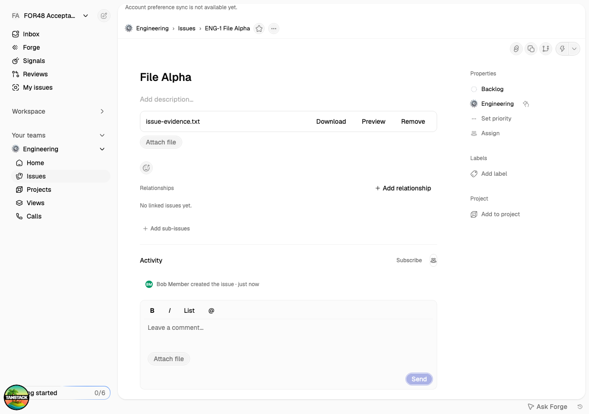

# FOR-48 durable issue and comment files

Implementation: `915fe3b` on `dev/for-48-durable-attachments`, based on `884445a`.
Verified on 31 October 2026. [Linear issue](https://linear.app/atriumcrm/issue/FOR-48/attach-durable-files-to-issues-and-comments).

## Behavior and accepted decision

Matthieu confirmed these rules in the implementation chat and Linear comment:

- Issue editors may attach and remove issue files. Comment files follow comment author/workspace owner/admin permissions.
- Removal immediately revokes downloads. The private object and checksum remain linked to the owning issue and its existing retention/recovery/purge lifecycle.
- A verified upload binds to one issue or comment. Pending, wrong-workspace, wrong-issue, wrong-uploader, and already-bound uploads fail closed.

Direct issue uploads finalize as `unbound`. A command atomically checks the ready intent, immutable metadata, owning issue, uploader, and current authorization before marking the file `attached` and publishing its metadata reference. Comment creation/editing and its new file bindings commit together. Detach marks the file `detached`, removes its reference, and emits an outbox event in the same command transaction. Comment-file changes use comment version checks; all commands use existing receipts/audit/outbox behavior.

Delivery uses the existing private, short-lived actor-bound grant transport and checks live issue access, attachment state, ownership, comment deletion, and the surviving reference before and after byte reads. Checksums are verified before bytes are returned. Preview content is served through the existing sanitized preview transport inside a sandboxed iframe.

The UI supports uploads, download, preview, detach, saved comment-upload drafts, and exact binding retries after interrupted responses. Issue creation uploads selected local files after the canonical issue receipt and checkpoints each binding. Newly created canonical file references contain metadata and an empty legacy `data` slot; source bytes are not embedded in issue properties. Legacy import snapshots remain under the existing import contract; bulk legacy-file migration remains FOR-56.

## Acceptance evidence

Environment: isolated `forge_auto_assignment_acceptance` database on branch `br-autumn-union-za0opf1e`, pooled application role, direct migration role, local development byte store. Production was not modified.

| Contract | Evidence |
| --- | --- |
| AT-01 / AC-01 | Real upload finalization, atomic binding, collaborator access, checksum and exact byte equality through replacement delivery/blob-store instances using the same persistent storage; browser collaborator download and reload. |
| AT-02 / AC-02 | Pending, foreign-user/issue, mixed valid/invalid, and reused uploads reject atomically; inaccessible private-team uploads and downloads reject. Unbound uploads do not receive grants. Detach and deleted comments invalidate previously issued grants; comment restoration restores surviving attachments. |
| Retry/recovery | Browser loses the binding response after commit, reloads, replays the saved command once, and verifies one attachment. Comment-upload drafts survive reload. Creation-selected files finish through the durable upload/bind flow. |
| Rollout compatibility | A simulated older finalizer creates a NULL-state direct upload after migration; delivery treats it as unbound, and the authorized binding command safely claims it. |

This verifies persistence through process/service replacement and browser reload. An actual hosted redeploy against production private Blob storage remains part of the release acceptance after PR review; no production rollout is claimed.

## Checks

- Both migrations rehearsed through the serialized runner: 59 total entries, repeat-safe ledger.
- Full PostgreSQL issue suite: **107 passed**. Final FOR-48 compatibility rerun: **3 passed**.
- Broad application suite: **2,295 passed**, 391 intentionally skipped, one timing-sensitive emoji-picker test failed. That complete seven-test file passed in an isolated rerun; the unchanged base revision also passed it. No emoji-picker code was changed.
- Final client/recovery regression run: **13 passed** (includes the creation projection regression).
- Workflow suite: **4 passed**.
- TypeScript and repository ESLint pass; ESLint reports existing warnings. Production build and protected Workflow-handler verification pass. `git diff --check` passes.
- Browser acceptance passes all seven checks and deletes its users, workspace, command receipts, upload intents, and local byte fixtures. A fixture left by an interrupted connection was separately removed.

Reproduce targeted checks with `bun run test:issue-files:postgres` and `bun run test:issue-files:browser` from `apps/forge`; configure the dedicated acceptance connection file using the environment variables documented in the scripts. The browser runner requires a local app and a dedicated `/tmp/for48-...` file directory.

## Review follow-up

The subsequent review fixed identity, unmount, and creation recovery issues. See [the review evidence](for48-review-and-release.md) for the final implementation and checks.

## Release

Apply `0058_issue_file_bindings` and `0059_issue_upload_binding_backfill` with the existing serialized migration runner before serving the new code. Internal resource files preserve their existing NULL-state contract; old direct issue uploads are backfilled to unbound, and a late old-process finalizer is handled safely by the new code. Production migration approval and deployment are separate from this PR.

Rolling back to code that predates FOR-48 would not enforce detach/comment-file revocation. Keep the new delivery checks when preparing any rollback after attachment writes have been enabled.

